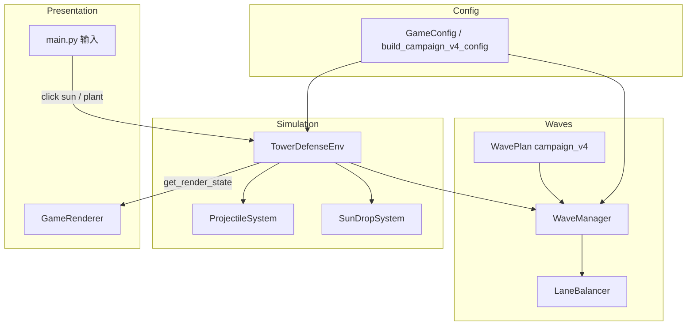

# PVZ v4 修改方案（详细设计）

> **产出路径**：`F:\desktop\py项目\pvz_v4_修改方案.md`  
> **基准代码**：`pvz_v3`（`config.py`、`env.py`、`renderer.py`、`main.py` 等）  
> **波次依据**：`pvz波次设置.docx`（设计规格见本文 §4；仓库内未找到该文件，以需求文档中的映射表为准）  
> **适用范围**：正式游玩主战役 `campaign_v4`；训练模式保持 `build_training_easy_config()` 独立简化波次。

---

# 1. 目标与范围

### 1.1 核心目标

| 目标 | 说明 |
|------|------|
| 表现实体化 | 豌豆射手发射可飞行 `projectile`，命中后扣血；向日葵产出可点击 `sun_drop` |
| 主战役脚本化 | 固定 **20** 波，移除随机 `wave_modifier` |
| 升级节奏固定 | 全局仅 **5** 次升级，节点：`w4`、`w8`、`w12`、`w16`、`w19` 清场后 |
| 开局节奏 | 首波前 **10s** 无僵尸；初始阳光 **150**；安全期内额外 **1** 次天空阳光 |
| 五路均衡 | 数量差 + 威胁差双约束，战役禁用 `single_lane` |

### 1.2 不在本次范围

- 新植物 / 新僵尸类型（沿用 `normal` / `pole_vaulting` / `buckethead`）
- 训练用 `legacy_random` 波次逻辑的大改（仅保证接口不破坏）
- 联网、存档、音效资源替换

---

## 2. pvz_v3 现状对照

### 2.1 已有基础（可复用）

`config.py` 已预留 v4 相关字段与工厂函数：

```python
# 已存在（节选）
wave_plan_id: str = "legacy_random"
opening_grace_seconds: float = 0.0
campaign_initial_resources: int = 100
opening_bonus_sky_sun_count: int = 0
lane_threat_weights: dict[str, float]  # normal=1.0, pole_vaulting=1.5, buckethead=2.5
projectile_speed_px_per_second: float = 360.0
sun_drop_idle_seconds: float = 10.0
sun_drop_auto_collect_delay: float = 0.75

def build_campaign_v4_config(seed: int = 42) -> GameConfig: ...
def build_training_easy_config(seed: int = 42) -> GameConfig: ...
```

### 2.2 关键缺口（必须实现）

| 模块 | 现状 | v4 要求 |
|------|------|---------|
| `waves.py` | **仓库中缺失**，但 `env.py` / 测试均 `from waves import ...` | 需新建完整波次模块（含 `campaign_v4` 脚本表） |
| 攻击 | `_resolve_tower_attacks()` **即时扣血**，无弹丸 | 先创建 `Projectile`，飞行碰撞后结算 |
| 阳光 | `_resolve_economy_production()` / `_grant_resources()` **直接 `resources +=`** | 先 `SunDrop` 实体；`MANUAL` 点击入账 |
| 波次 | 默认 `total_waves=5`，随机 modifier | 20 波固定脚本，无 modifier |
| 升级 | **每波清场**都可能进入 `upgrade` | 仅 5 个 checkpoint 波进入升级 |
| 开局 | `initial_resources=100`，无 grace | `150` + 10s grace + 1 次奖励天空阳光 |
| 分路 | `single_lane` modifier 可集中一路 | `campaign_v4` 禁用，统一 `LaneBalancer` |
| 渲染 | `renderer.py` 无 `projectiles` / `sun_drops` | 新增绘制与点击命中区域 |
| `get_render_state()` | 无上述新字段 | 扩展观测与 HUD 调试信息 |

### 2.3 相关代码锚点

- 即时攻击：`env.py` → `_resolve_tower_attacks()`（约 1199–1218 行）
- 阳光直加：`env.py` → `_resolve_economy_production()`、`_grant_resources()`（约 987–1016 行）
- 波次推进：`env.py` → `_resolve_wave_progression()`（每波清场即 `upgrade`）
- 分路偏斜：`env.py` → `_spawn_enemy()` 中 `single_lane` 分支（约 1074–1079 行）

---

## 3. 总体架构



**数据流（单帧）**：

1. `step` / `_advance_world`：更新 grace、天空阳光、波次计时、生成队列  
2. `ProjectileSystem.tick`：移动弹丸 → 命中扣血 → 移除  
3. `SunDropSystem.tick`：非手动模式延迟后自动飞向 HUD 并入账  
4. 敌人 / 植物逻辑（与 v3 相同顺序，攻击改为“发射弹丸”而非直伤）  
5. 清场检测 → 按 `checkpoint_upgrade` 决定是否进入升级

---

## 4. 波次脚本设计（campaign_v4）

### 4.1 波次配置结构（`WaveConfig`）

每条波次除索引外，使用结构化字段替代单一 `enemy_count`：

```python
@dataclass(frozen=True)
class WaveConfig:
    wave_id: int                          # 1..20
    fixed_counts: dict[str, int]          # {"normal": 5, "pole_vaulting": 2}
    random_slots: int                     # 随机位数量（先采样类型再分路）
    actual_total_range: tuple[int, int]   # (min, max) 含固定+随机后的总数
    first_spawn_delay: float              # 波内计时起点到首只僵尸
    last_spawn_target: float              # 最后一只目标生成时刻（波内相对时间）
    checkpoint_upgrade: bool              # 清场后是否进入升级
    spawn_interval: float                 # 由 last_spawn_target 与 actual_total 反推
    modifier: WaveModifier                # campaign_v4 固定为 steady（无效果）
```

**采样顺序（每波开始一次）**：

1. `actual_total = randint(min, max)`  
2. `fixed_spawn_list` = 按 `fixed_counts` 展开为类型列表  
3. `random_count = actual_total - len(fixed_spawn_list)`，截断到 `[0, random_slots]`  
4. 对 `random_count` 次按权重抽样类型（见 §4.3）  
5. 合并为 `spawn_queue: list[EnemySpawnSpec]`，交 `LaneBalancer` 分配 `row`  
6. `WaveManager` 按时间轴弹出并 `_spawn_enemy`

### 4.2 二十波明细表

| 波次 | fixed_counts | random_slots | actual_total | 升级点 | 备注 |
|------|--------------|--------------|--------------|--------|------|
| w1 | 1×normal | 0 | 1 | 否 | 首只 delay=10s，末只 target=25s |
| w2 | 1×normal | 0 | 1 | 否 | 首只 6.01s |
| w3 | 1×normal | 0 | 1 | 否 | |
| w4 | — | 2 | 1–2 | **是** | 随机权重 w4–w9 |
| w5 | — | 2 | 1–2 | 否 | |
| w6 | — | 2 | 1–2 | 否 | |
| w7 | 1×normal | 2 | 2–3 | 否 | |
| w8 | 1×normal | 2 | 2–3 | **是** | |
| w9 | 3×normal | 4 | 5–7 | 否 | |
| w10 | 5×normal + 2×pole | 6 | 10–12 | 否 | 固定配方必须出现 |
| w11 | — | 6 | 2–4 | 否 | |
| w12 | — | 6 | 3–6 | **是** | |
| w13 | 2×normal | 6 | 5–8 | 否 | |
| w14 | 2×normal | 6 | 5–8 | 否 | |
| w15 | 2×normal | 6 | 5–8 | 否 | |
| w16 | — | 8 | 5–8 | **是** | 权重 w10–w19 |
| w17 | — | 8 | 5–8 | 否 | |
| w18 | — | 8 | 5–8 | 否 | |
| w19 | 5×normal | 8 | 11–13 | **是** | |
| w20 | 12×normal + 7×pole + 6×bucket | 0 | **25** | 否 | 无随机；清场即胜利 |

**升级节点汇总**：`w4`、`w8`、`w12`、`w16`、`w19` → 共 **5** 次；`w20` 清场后直接 `victory`，不升级。

### 4.3 随机僵尸权重

| 波次区间 | normal | pole_vaulting | buckethead |
|----------|--------|---------------|------------|
| w4–w9 | 40% | 60% | 0% |
| w10–w19 | 25% | 45% | 30% |
| w20 | — | — | 无随机位 |

实现：`random.choices(types, weights=..., k=1)`，种子由 `WaveManager` 的 `random.Random` 控制，保证同 seed 可复现。

### 4.4 时间轴规则

| 规则 | 值 |
|------|-----|
| 全局开局 grace | `opening_grace_seconds = 10.0`，期间 `_progress_wave_spawns` 不推进 w1 |
| w1 首只 | 波内 `first_spawn_delay = 10.0`（= grace 结束后立即进入 w1 计时，或 grace 与 w1 合并为“游戏开始后 10s 首只”——**采用：游戏时间 ≥10s 且 w1 active 后首只**） |
| w2–w20 首只默认 | `first_spawn_delay = 6.01`（清场后立即下一波，波内相对 6.01s） |
| 末只 target（按该波 **max(actual_total_range)**） | ≤3 → 25s；4–8 → 28s；≥9 → 31s |
| 刷怪间隔 | `spawn_interval = (last_target - first_delay) / max(1, total - 1)`，末只对齐 `last_spawn_target` |

**清场触发下一波**：上一波 `is_wave_cleared` 后，若需升级则 `wave_state=upgrade`；否则 `WaveManager.start_next_wave()`，波内计时器归零。

**w1 与 grace 的统一语义（推荐实现）**：

- `game_time < 10.0`：禁止任何僵尸生成；允许天空阳光、放置植物、弹丸逻辑  
- `game_time >= 10.0` 且 w1：`first_spawn_delay` 相对于 **w1 开始时刻** 为 0（因 grace 已消耗），首只立即按 w1 表在 10s 出现；若文档要求“波内首只 10s、末只 25s”，则 w1 的 `first_spawn_delay=0`，`last_spawn_target=15`（25-10）

> 与需求对齐：**w1 首只在游戏开始后 10.0s，末只在 25s** → w1 波内窗口长度 15s。

### 4.5 WaveManager 行为变更

| 项目 | v3（推断/缺失实现） | v4 |
|------|---------------------|-----|
| `total_waves` | 硬编码 5 | 由 `WavePlan` 决定，campaign=20 |
| modifier 抽取 | 随机 | `campaign_v4` 不抽取，恒为 `steady` |
| `lane_mode` | 可能 `single_lane` | `campaign_v4` 强制 `spread` + `LaneBalancer` |
| 波次定义来源 | `wave_base_enemy_count` 递增 | `CAMPAIGN_V4_WAVES` 常量表 |

---

## 5. 五路平衡（LaneBalancer）

### 5.1 威胁权重

与 `config.lane_threat_weights` 一致：

| 类型 | 权重 |
|------|------|
| normal | 1.0 |
| pole_vaulting | 1.5 |
| buckethead | 2.5 |

每路维护：

- `spawn_count[row]`：本波已分配数量  
- `threat_score[row]`：已分配僵尸权重累加  
- `alive_enemy_count[row]`：运行时由 `env` 同步（供 HUD / 调试）

### 5.2 分配算法

对队列中每一只僵尸（**固定怪与随机怪同一流程**）：

1. 候选行 = 满足硬性约束的行集合  
2. 选 `threat_score` **最小** 的行；并列则 `spawn_count` 最小；再并列 `random.choice`  
3. 更新该路 `spawn_count`、`threat_score`  
4. **同路连续**：若上一只也在该行，且存在其它可行行，则禁止连续第 3 只（同路最多连 2）  
5. **开段优先**：波内前 5 次分配，优先选本波尚未出现过的行（在硬约束可行前提下）

### 5.3 硬性约束

设 `N = 本波 actual_total`，`T[row]` 为威胁分：

| 条件 | 约束 |
|------|------|
| `N <= 10` | `max(spawn_count) - min(spawn_count) <= 1` |
| `N > 10` | `max(spawn_count) - min(spawn_count) <= 2` |
| 非 w20 | `max(T) - min(T) <= 2.5` |
| w20 | `max(T) - min(T) <= 3.5` |

**w20 特殊顺序**（在总配方 12/7/6 确定后）：

1. 6 只 `buckethead` 优先各占不同路（至少 spread 到 6 路，路数 5 时允许 1 路 2 只但需满足威胁差）  
2. 7 只 `pole_vaulting`  
3. 12 只 `normal` 填满并微调以满足数量差/威胁差

### 5.4 与 env 集成

- `WaveManager.build_spawn_schedule()` 返回 `list[WaveSpawn(enemy_type_id, row, spawn_at)]`  
- `_spawn_enemy(..., row=spawn.row)` **不再**因 modifier 覆盖 row（campaign 模式）  
- `get_render_state()["lane_pressure"]` 每帧刷新 `alive_enemy_count`

---

## 6. 表现层：弹丸（Projectile）

### 6.1 数据模型

```python
@dataclass
class Projectile:
    uid: str
    row: int
    x: float
    y: float
    speed: float          # config.projectile_speed_px_per_second
    damage: int
    source_tower_id: str
    target_enemy_id: str | None  # 可选：锁定首发目标，穿透前单目标
```

### 6.2 逻辑规则

1. 豌豆射手 `ready` 且有目标 → **创建弹丸**，`tower.trigger(cooldown)`，不即时 `take_damage`  
2. 每帧：`x += speed * dt`（沿行向右）  
3. 碰撞：与同行僵尸 `rect` 相交 → 对首个命中敌人 `take_damage`；若死亡则结算击杀奖励  
4. 飞出网格右边界或左边界（无目标）→ 销毁  
5. 同一帧多弹丸命中同一敌人：按创建顺序依次结算（或合并伤害，需单测固定一种）

### 6.3 渲染（renderer.py）

- 在 `_draw_enemies` 之后、HUD 之前绘制  
- 形态：小圆或椭圆，颜色 `(140, 220, 100)`，半径 `config.projectile_radius_px`  
- `get_render_state()["projectiles"]` 为空列表时 **跳过绘制**（回归要求）

### 6.4 RL / 训练兼容

- `step` 奖励仍以击杀为准；弹丸仅延迟伤害时刻，不改变奖励公式  
- 训练模式可保留即时伤害（`wave_plan_id != campaign_v4` 时走旧逻辑）或统一弹丸（推荐统一，减少分支）

---

## 7. 表现层：阳光掉落（SunDrop）

### 7.1 来源

| 来源 | 行为 |
|------|------|
| 向日葵产出 | 原 `produced_sun` 不直接入账 → 在植物附近生成 `SunDrop(amount=25×倍率)` |
| 天空阳光 | 原 `_grant_resources` 在 grace 后生成天空位置 `SunDrop` |
| 开局奖励 | `opening_bonus_sky_sun_count=1`，在 `game_time ≈ opening_bonus_sky_sun_delay`（默认 5s）生成 1 次，**仅 w1 grace 内** |

### 7.2 数据模型

```python
@dataclass
class SunDrop:
    uid: str
    x: float
    y: float
    amount: int
    age: float
    state: Literal["idle", "collecting", "collected"]
```

### 7.3 收集规则

| 模式 | 行为 |
|------|------|
| `MANUAL`（main `MODE_MANUAL`） | 点击命中矩形 → `resources += amount`，标记 `collected`；**未点击不入账** |
| `RULE AI` / `MODEL AI` | 生成后 `sun_drop_auto_collect_delay`（0.75s）→ 飞向屏幕顶部阳光 HUD → 入账；AI `step` 无需额外动作 |

**空闲超时**：`sun_drop_idle_seconds`（10s）后自动消失或自动收集（二选一，推荐：非手动自动收集，手动模式超时消失并提示）

### 7.4 main.py 输入扩展

在 `pygame.MOUSEBUTTONDOWN` 处理中：

1. 先检测 `env.try_collect_sun_drop(pos)`  
2. 再处理升级卡片 / 种植  

### 7.5 渲染

- 绘制于棋盘之上、植物之下或之上（推荐植物之上、敌人之下）  
- 简单黄色圆 + 光晕；`collecting` 状态插值到 HUD 坐标  

---

## 8. 开局经济

| 配置项 | v3 默认 | v4 campaign |
|--------|---------|-------------|
| `initial_resources` / `campaign_initial_resources` | 100 | **150** |
| `opening_grace_seconds` | 0 | **10.0** |
| `opening_bonus_sky_sun_count` | 0 | **1** |
| `opening_bonus_sky_sun_delay` | 5.0 | 5.0（grace 内） |

**reset 逻辑**：

```python
if config.wave_plan_id == "campaign_v4":
    self.resources = config.campaign_initial_resources
else:
    self.resources = config.initial_resources
```

**安全期天空阳光**：在 `[0, 10s)` 内仅触发 **1** 次奖励掉落（独立于常规天空阳光计时器）；进入 w1 后常规 `sky_sun` 间隔继续。

---

## 9. 升级系统改造

### 9.1 触发条件

修改 `_resolve_wave_progression()`：

```python
if cleared_wave.checkpoint_upgrade:
    self.wave_state = "upgrade"
    self._set_pending_upgrade_options(...)
else:
    self._start_next_wave()  # 无升级直接下一波
```

`w20` 清场 → `victory=True`，`wave_state=finished`，**不**进入 upgrade。

### 9.2 与 v3 差异

- v3：`waves_cleared < total_waves` 时几乎每波都 `upgrade`  
- v4：仅 5 个 checkpoint；`auto_select_upgrades=False`（campaign 配置已设）时手动选卡  

### 9.3 全局计数校验

- `upgrade_counts` 总和在胜利时 `== 5`（允许同 upgrade 重复堆叠）  
- 测试：打通 20 波后 `len(applied_upgrades) == 5`（若每波只选 1 个）

---

## 10. 配置层（config.py）

### 10.1 建议默认值（campaign）

```python
wave_plan_id = "campaign_v4"
total_waves = 20
opening_grace_seconds = 10.0
campaign_initial_resources = 150
opening_bonus_sky_sun_count = 1
initial_resources = 150  # 或 campaign 工厂内覆盖
auto_select_upgrades = False  # 正式游玩
```

### 10.2 `build_campaign_v4_config`

保持现有工厂，补充：

- `wave_modifier_pool` 在 campaign 运行时不再被抽取（代码层忽略即可）  
- 显式 `total_waves=20`

### 10.3 `build_training_easy_config`

**不变更**：

- `wave_plan_id="legacy_random"`  
- `total_waves=2`  
- 不绑定 20 波与 5 次升级  

---

## 11. 环境接口扩展

### 11.1 `get_render_state()` 新增字段

```python
{
    "projectiles": [...],           # list[dict]
    "sun_drops": [...],             # list[dict]
    "opening_grace_remaining": float,
    "lane_pressure": [
        {"row": 0, "spawn_count": 0, "threat_score": 0.0, "alive_enemy_count": 0},
        ...
    ],
    "wave": {
        "current": {
            ...
            "checkpoint_upgrade": bool,
        },
    },
}
```

### 11.2 建议新增 env 方法

| 方法 | 用途 |
|------|------|
| `try_collect_sun_drop(pos) -> bool` | main 点击收集 |
| `lane_pressure_snapshot() -> list[dict]` | 渲染 / 调试 |
| `opening_grace_remaining() -> float` | HUD 显示“准备阶段” |

### 11.3 状态编码（RL）

- 现有 `STATE_*` 向量 **可不纳入** 弹丸/阳光位置（避免维度爆炸）  
- 训练仍用 `get_training_state()`；战役可视化用 `get_render_state()`  

---

## 12. 渲染层改造（renderer.py）

### 12.1 绘制顺序

1. 棋盘  
2. 植物  
3. **阳光实体**  
4. 敌人  
5. **弹丸**  
6. HUD / 升级遮罩 / 结算  

### 12.2 HUD 增强（可选）

- `opening_grace_remaining > 0`：显示“准备阶段 Xm.Xs”  
- 调试模式：五路 `lane_pressure` 小条（spawn / threat / alive）  

### 12.3 空列表安全

```python
for p in state.get("projectiles") or []:
    ...
for s in state.get("sun_drops") or []:
    ...
```

---

## 13. 新文件与模块划分

### 13.1 `waves.py`（新建，高优先级）

| 类型 | 名称 |
|------|------|
| 数据类 | `WaveModifier`, `WaveConfig`, `WaveSpawn`, `EnemySpawnSpec` |
| 类 | `WavePlan`, `WaveManager`, `LaneBalancer` |
| 常量 | `CAMPAIGN_V4_WAVES: list[WaveConfig]` |
| 函数 | `build_wave_manager(config) -> WaveManager` |

### 13.2 `entities.py` 或内嵌 env（可选）

- `Projectile`, `SunDrop`  
- 亦可放在 `env.py` 顶部私有 dataclass，视文件长度而定  

### 13.3 测试文件

- `test_campaign_v4_waves.py`：波次表、权重、时间轴  
- `test_lane_balancer.py`：五路约束  
- `test_projectiles_sun_drops.py`：表现与收集  
- 扩展 `test_env_compatibility.py`：campaign 不破坏训练 config  

---

## 14. 实施阶段建议

| 阶段 | 内容 | 验收 |
|------|------|------|
| P0 | 新建 `waves.py` + `LaneBalancer` + 20 波表 | 单元测试通过；`import waves` 恢复 |
| P1 | `WaveManager` 接入 env；禁用 campaign 的 single_lane | w1 10s 无怪；w20 配方 25 只 |
| P2 | checkpoint 升级 + w20 胜利 | 升级恰好 5 次 |
| P3 | `Projectile` 系统 + 渲染 | 先显示后命中 |
| P4 | `SunDrop` + main 点击 + 自动收集 | 手动不入账；AI 自动 |
| P5 | 开局 150 + bonus 天空阳光 | 经济测试 |
| P6 | `get_render_state` 扩展 + 回归测试 | 训练 config 不受影响 |

---

## 15. 测试计划（详细）

### 15.1 波次正确性

- [ ] `game_time < 10` 时无僵尸生成  
- [ ] w4–w6：每波 `actual_total ∈ [1, 2]`  
- [ ] w10：固定含 `5 normal + 2 pole_vaulting`（在 min 总数下仍保留固定部分）  
- [ ] w20：严格 `12 normal + 7 pole + 6 bucket`，无随机位  

### 15.2 升级正确性

- [ ] 仅 w4、w8、w12、w16、w19 清场后 `wave_state == "upgrade"`  
- [ ] 全程升级次数 = 5  
- [ ] w20 清场后 `victory` 且无 `pending_upgrade_options`  

### 15.3 五路平衡

- [ ] 非 w20：数量差、威胁差满足 §5.3  
- [ ] w20：铁桶不堆在单路（6 桶分散，至少 4 路各有桶）  
- [ ] 前 5 只生成：无单路连续 3+（除非硬约束迫使）  

### 15.4 开局经济

- [ ] `resources == 150` after reset（campaign）  
- [ ] grace 内恰好 1 次 bonus 天空阳光  

### 15.5 表现层

- [ ] 弹丸飞行可见，命中前敌人 HP 不变  
- [ ] MANUAL：未点击阳光不计入 `resources`  
- [ ] RULE/MODEL：阳光自动收集且不阻塞 `step`  

### 15.6 回归

- [ ] `projectiles` / `sun_drops` 缺省或 `[]` 时 renderer 不报错  
- [ ] `build_training_easy_config()` 仍为 2 波、无 5 次升级约束  
- [ ] `test_rl_training_contract.py` / `test_env_compatibility.py` 通过  

---

## 16. 假设与风险

| 假设 | 说明 |
|------|------|
| 方案面向正式游玩 | 训练模式继续简化波次 |
| 经济增强为中度 | 150 + 1 次天空阳光，非无限阳光 |
| 实体为仿真一部分 | 非纯动画；影响手动收集与 AI 自动收集时机 |
| docx 未入库 | 波次数字以本方案 §4.2 为准；若 docx 后续提供差异，以 docx 为准修订表 |

| 风险 | 缓解 |
|------|------|
| `waves.py` 缺失导致当前无法运行 | P0 最先补齐并实现最小 `legacy_random` 兼容 |
| 弹丸延迟改变难度曲线 | 适当微调 `projectile_speed` 或植物 `attack_interval` |
| w20 分路约束过严导致分配失败 | `LaneBalancer` 回退：放宽次要约束并打日志 |
| RL 状态不含弹丸 | 训练不依赖弹丸位置；必要时 FastCompatibilityEnv 仍用即时伤 |

---

## 17. 附录：campaign_v4 波次 Python 草图

```python
CAMPAIGN_V4_WAVES = [
    WaveConfig(1, {"normal": 1}, 0, (1, 1), 10.0, 25.0, False),
    WaveConfig(2, {"normal": 1}, 0, (1, 1), 6.01, 25.0, False),
    # ... w3 ..
    WaveConfig(4, {}, 2, (1, 2), 6.01, 25.0, True),
    # ... 直至 ...
    WaveConfig(20, {"normal": 12, "pole_vaulting": 7, "buckethead": 6}, 0, (25, 25), 6.01, 31.0, False),
]
```

---

## 18. 文档修订记录

| 版本 | 日期 | 说明 |
|------|------|------|
| 1.0 | 2026-05-18 | 初稿：基于 pvz_v3 代码审查 + 需求规格整理 |

---

##### **下一步（实现时）**：在 `pvz_v3` 仓库按 P0→P6 落地；或复制为 `pvz_v4` 分支后执行。若提供 `pvz波次设置.docx`，可对照 §4.2 做逐波 diff 并更新修订记录。