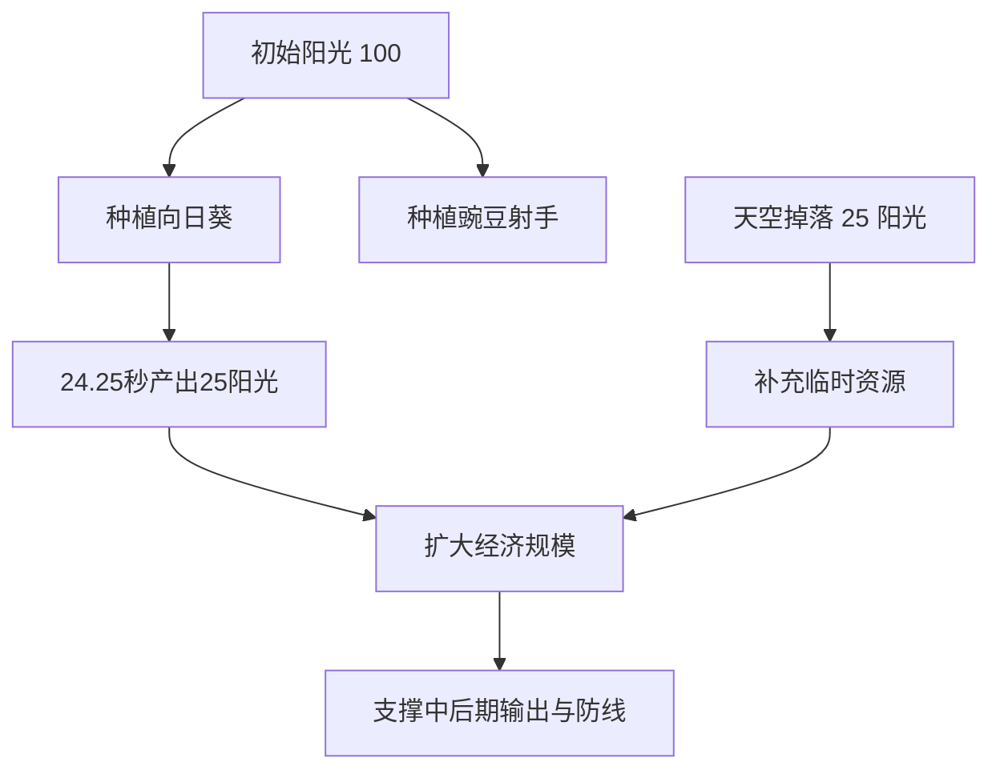

# 游戏后期拓展方案书2：PVZ原版数值平衡与僵尸重构

> 文档定位：项目后期第三步拓展说明  
> 当前状态：已完成实现  
> 适用场景：阶段汇报、结题材料、答辩讲解、版本说明

---

## 一、拓展背景

在前一阶段中，项目已经完成了“局内强化 + 随机变量系统”的后期拓展，使游戏从基础塔防原型逐步向类 PVZ 的动态策略环境演进。

但在实际运行与测试过程中，仍然暴露出一个明显问题：

> **游戏机制已经更丰富，但核心数值体系仍不够稳定，导致植物投入收益、僵尸压制强度、经济节奏与战斗节奏之间存在不平衡。**

具体表现为：

1. 部分植物的投入成本与实际收益不匹配，影响玩家布阵决策。
2. 僵尸强度层次不够清晰，敌人差异化体验不足。
3. 卡牌冷却、阳光掉落与植物产能之间缺乏更接近 PVZ 原版的节奏控制。
4. 在 AI 训练环境中，数值波动会直接影响策略学习质量，导致部分行为偏离预期。

因此，在前述拓展已完成的基础上，我们进一步开展了**第三步拓展**：

> **参考《植物大战僵尸1》原版的核心数值逻辑，对植物、僵尸、阳光系统与卡牌冷却进行统一重配，并将敌人类型收敛为普通僵尸、铁桶僵尸、撑杆僵尸三类典型对象。**

---

## 二、拓展目标

本次“拓展方案书2”的核心目标不是新增更多机制，而是对已有机制进行一次**数值层面的回归校准与结构化重构**。

目标如下：

1. 提升游戏整体节奏与 PVZ1 原版体验的一致性。
2. 让植物与僵尸之间形成更清晰的克制关系。
3. 使阳光生产、空投阳光、卡牌冷却之间形成稳定经济闭环。
4. 保留前一阶段的强化与随机变量系统，同时让其建立在更合理的基础数值之上。
5. 为后续 AI 训练、策略对比和实验记录提供更稳定的环境。

---

## 三、版本演进关系


本次拓展可理解为：

- 它不是推翻前一阶段设计。
- 它是在前一阶段玩法系统完成后，对“底层数值层”进行校准。
- 它让强化系统、随机系统、波次系统有了更合理的运行基础。

---

## 四、核心设计思路

本次数值重构遵循三条原则：

### 4.1 原版参考原则

植物血量、僵尸血量、移动速度、攻击间隔、卡牌冷却、阳光掉落频率等关键参数，以 PVZ1 原版节奏为主要参考依据进行回调。

### 4.2 层次清晰原则

不同单位不再只是“数值高低不同”，而是具备明确战术定位：

- 豌豆射手负责稳定输出
- 向日葵负责经济运营
- 坚果负责前排承伤
- 普通僵尸负责基础施压
- 铁桶僵尸负责高血量推进
- 撑杆僵尸负责节奏打乱与前排突破

### 4.3 兼容拓展原则

数值重构不破坏既有系统，而是与下列模块兼容：

- 波次推进系统
- 三选一局内强化系统
- 波次词条系统
- 地图强化格系统
- AI 决策状态接口

---

## 五、植物系统数值调整

本次调整后，植物基础配置如下：

| 植物 | 定位 | 阳光消耗 | 伤害 | 攻击间隔 | 卡牌CD | 最大生命值 | 额外机制 |
|---|---:|---:|---:|---:|---:|---:|---|
| 豌豆射手 | 输出核心 | 100 | 20 | 1.5 秒 | 7.5 秒 | 300 | 9 格射程 |
| 向日葵 | 经济核心 | 50 | 0 | - | 7.5 秒 | 300 | 24.25 秒产出 25 阳光 |
| 坚果墙 | 防御核心 | 50 | 0 | - | 30 秒 | 4000 | 高血量承伤 |

### 5.1 调整后的节奏意义

1. **豌豆射手**  
   保持中等成本、稳定输出，适合作为主力远程单位。

2. **向日葵**  
   恢复为明确的经济植物，不再承担额外战斗职责，使“前期扩经济 or 先保命”重新成为有效决策。

3. **坚果墙**  
   以高血量和长冷却形成“高价值前排单位”，避免被过度滥用，同时强化防守意义。

### 5.2 植物数值可视化

以“功能定位”而非单纯强弱来观察：

```text
植物功能分布

豌豆射手  输出: ██████████  经济:          防御: ██
向日葵    输出:            经济: ██████████  防御: ██
坚果墙    输出:            经济:            防御: ██████████
```

---

## 六、阳光与卡牌节奏调整

本次拓展对阳光系统进行了统一回调，使资源节奏更接近原版 PVZ 的“持续运营型经济”。

### 6.1 阳光系统

当前配置如下：

| 项目 | 数值 |
|---|---:|
| 初始阳光 | 100 |
| 天降阳光单次值 | 25 |
| 天降阳光间隔 | 7.5 ~ 10.0 秒 |
| 向日葵单次产量 | 25 |
| 向日葵产出间隔 | 24.25 秒 |

### 6.2 卡牌冷却

| 卡牌 | 冷却时间 |
|---|---:|
| 豌豆射手 | 7.5 秒 |
| 向日葵 | 7.5 秒 |
| 坚果墙 | 30.0 秒 |

### 6.3 调整效果

1. 前期资源不再过快膨胀，玩家需要权衡经济建设与战线防守。
2. 输出卡和经济卡冷却一致，便于形成基础布阵节奏。
3. 坚果墙长冷却保证了其战略价值，减少无脑堆前排的情况。

### 6.4 资源节奏示意



---

## 七、僵尸系统重构

本次第三步拓展将敌人类型统一重构为三类：

1. 普通僵尸
2. 铁桶僵尸
3. 撑杆僵尸

这三类僵尸覆盖了**基础压力、高血量推进、特殊突破**三种典型战斗角色，既便于教学展示，也便于 AI 学习策略差异。

### 7.1 僵尸基础数值表

| 僵尸类型 | 血量 | 速度 | 伤害 | 攻击间隔 | 击杀奖励 | 特性 |
|---|---:|---:|---:|---:|---:|---|
| 普通僵尸 | 270 | 16 | 100 | 1.0 秒 | 20 | 属性均衡 |
| 铁桶僵尸 | 1370 | 16 | 100 | 1.0 秒 | 30 | 高血量、高压推进 |
| 撑杆僵尸 | 340 | 32 / 16 | 100 | 1.0 秒 | 25 | 首次可越过一个植物 |

### 7.2 撑杆僵尸机制说明

撑杆僵尸是本次重构中最关键的差异化敌人：

- 初始移动速度为 `32`
- 跳过首个植物前保持高速推进
- 成功完成跳跃后恢复到常规速度 `16`
- 能直接威胁依赖单层前排的防守阵型

这使其不只是“更快的僵尸”，而是**对阵型结构具有针对性的机制型敌人**。

### 7.3 僵尸强度对比可视化

以下以“普通僵尸 = 1.00”作为基准：

| 僵尸类型 | 血量倍率 | 移速倍率 | 奖励倍率 |
|---|---:|---:|---:|
| 普通僵尸 | 1.00 | 1.00 | 1.00 |
| 铁桶僵尸 | 5.07 | 1.00 | 1.50 |
| 撑杆僵尸 | 1.26 | 2.00（跳前）/ 1.00（跳后） | 1.25 |

```text
血量对比（普通僵尸 = 1.00）

普通僵尸    ███ 1.00
铁桶僵尸    ███████████████ 5.07
撑杆僵尸    ████ 1.26
```

```text
速度对比（普通僵尸 = 1.00）

普通僵尸    ███ 1.00
铁桶僵尸    ███ 1.00
撑杆僵尸    ██████ 2.00（跳前）
撑杆僵尸    ███ 1.00（跳后）
```

---

## 八、与前一阶段拓展系统的衔接

本次数值重构并不是孤立存在，而是直接服务于上一阶段已经完成的玩法系统。

### 8.1 对局内强化系统的意义

在数值更稳定后，强化效果会更加清晰：

- `伤害提升` 更容易被玩家感知
- `攻速提升` 与豌豆射手主输出模型更匹配
- `阳光增产` 与向日葵经济系统结合更自然
- `坚果生命强化` 在高血量前排模型下更具战略价值

### 8.2 对随机波次系统的意义

三类僵尸重构后，不同波次组合的战术价值更明确：

- 普通僵尸波：基础资源运营测试
- 铁桶僵尸波：持续火力与前排质量测试
- 撑杆僵尸波：阵型完整性与反应能力测试

### 8.3 对 AI 决策系统的意义

AI 不再只面对“数量变化”，而是要识别不同敌人类型带来的结构性压力：

1. 是否提前建设前排防线  
2. 是否优先补经济  
3. 是否面对撑杆僵尸时减少单层挡位依赖  
4. 是否在铁桶波次前提前铺设连续输出

---

## 九、实现层面的具体成果

结合当前项目代码，本次第三步拓展已经落实为以下结果：

1. 植物基础配置已统一写入数值配置模块。
2. 普通、铁桶、撑杆三类僵尸配置已完成替换。
3. 旧的 `fast`、`tank` 命名保留为兼容别名，保证旧逻辑与旧测试不直接失效。
4. 天降阳光、植物产阳光、卡牌冷却均已按新节奏接入。
5. 撑杆僵尸已具备“首次越过植物后降速”的行为逻辑。
6. 当前强化池、波次词条与地图效果系统能够继续复用，不需要推翻重写。

---

## 十、预期效果分析

完成本次数值重构后，项目在展示层面与研究层面都有明显收益。

### 10.1 游戏体验层面

1. 战斗节奏更接近经典 PVZ。
2. 资源运营与防守部署之间的取舍更明显。
3. 三类僵尸形成了清晰的战术识别度。
4. 玩家更容易感受到“经济建立 - 防线成型 - 波次应对”的完整流程。

### 10.2 项目汇报层面

1. 可以证明项目不仅增加了玩法，还完成了系统级平衡优化。
2. 更容易说明“为什么要做数值回调”以及“如何参考原版进行设计”。
3. 能体现项目从“功能实现”走向“体验优化”和“实验环境优化”。

### 10.3 AI 研究层面

1. 数值更加稳定，有利于训练数据收敛。
2. 敌人类型更有代表性，有助于观察策略泛化能力。
3. 强化系统、随机变量系统与基础数值之间的耦合关系更清晰，便于后续实验分析。

---

## 十一、阶段总结

本次“拓展方案书2”对应的是项目后期中的一次**数值平衡优化与敌人结构重构**。其本质作用在于：

> **让前一阶段已经实现的玩法系统，真正建立在接近 PVZ 原版逻辑、且更适合策略推演与 AI 训练的数值基础之上。**

通过这一步，项目不再只是“带有 PVZ 元素的塔防游戏”，而是进一步向以下目标靠近：

- 规则结构更完整
- 数值层次更合理
- 策略对抗更清晰
- AI 训练环境更稳定

因此，本次拓展具有明显的中期承上启下作用，是连接“机制拓展”和“智能训练”的关键一步。

---

## 十二、汇报可直接引用的简述版本

可在阶段汇报或答辩中使用如下表述：

> 在完成局内强化与随机变量系统后，我们进一步发现游戏仍存在基础数值不平衡的问题。为此，项目开展了第三步拓展：参考《植物大战僵尸1》原版的核心数值逻辑，对植物血量、攻击节奏、卡牌冷却、阳光掉落和僵尸属性进行了统一调整。  
>
> 同时，我们将敌人类型重构为普通僵尸、铁桶僵尸和撑杆僵尸三类，其中撑杆僵尸具备首次越过植物的特殊机制，使敌人差异化更加明显。  
>
> 这一步拓展的意义在于：它让前期已经完成的强化系统与随机变量系统建立在更合理的数值基础上，既提升了游戏体验，也提高了 AI 训练环境的稳定性与策略研究价值。
